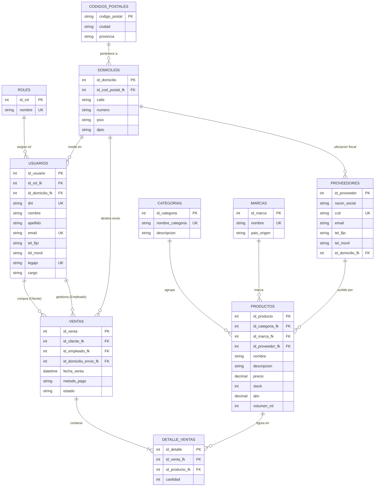

# Especificación de la Base de Datos — Moonshine Ballad

Diseño relacional, entidades, atributos, tipos de claves y relaciones que componen la base de datos.

---

## 🎨 Diagrama de Entidades y Relaciones (Mermaid.js)

---

## 📑 Especificación de Tablas y Atributos

### 1. Rol (`roles`)

- **`id_rol`** (PK, INT, Auto-increment) — Identificador único del rol.
- **`nombre`** (VARCHAR(30), Unique) — Denominación del nivel de acceso (`Admin`, `Cliente`).

---

### 2. Código Postal (`codigos_postales`)

- **`codigo_postal`** (PK, VARCHAR(15)) — Clave primaria que identifica el código postal (ej. `S3000`).
- **`ciudad`** (VARCHAR(30)) — Nombre de la localidad asociada.
- **`provincia`** (VARCHAR(30)) — Provincia o jurisdicción geográfica.

---

### 3. Domicilio (`domicilios`)

- **`id_domicilio`** (PK, INT, Auto-increment) — Identificador único de la dirección.
- **`cod_postal_fk`** (FK, VARCHAR(15)) — Referencia al código postal correspondiente.
- **`calle`** (VARCHAR(50)) — Nombre de la arteria vial.
- **`numero`** (VARCHAR(10)) — Altura catastral de la propiedad.
- **`piso`** (VARCHAR(10), Nullable) — Número de piso en edificaciones de departamento.
- **`dpto`** (VARCHAR(10), Nullable) — Unidad/Departamento específico.

---

### 4. Usuario (`usuarios`)

- **`id_usuario`** (PK, INT, Auto-increment) — Identificador único de la cuenta.
- **`id_rol_fk`** (FK, INT) — Referencia al rol de permisos asignado.
- **`id_domicilio_fk`** (FK, INT) — Referencia al domicilio habitual registrado.
- **`dni`** (VARCHAR(20), Unique) — Número de documento de identidad.
- **`nombre`** (VARCHAR(30)) — Primer y segundo nombre del usuario.
- **`apellido`** (VARCHAR(30)) — Apellido/s del usuario.
- **`email`** (VARCHAR(40), Unique) — Correo electrónico de contacto y credencial de acceso.
- **`tel_fijo`** (VARCHAR(20), Nullable) — Teléfono de red fija de contacto.
- **`tel_movil`** (VARCHAR(20), Nullable) — Teléfono móvil o celular de contacto.
- **`legajo`** (VARCHAR(20), Unique, Nullable) — Identificador laboral interno (exclusivo para empleados).
- **`cargo`** (VARCHAR(30), Nullable) — Puesto de trabajo asignado dentro del sistema (exclusivo para empleados).

---

### 5. Categoría (`categorias`)

- **`id_categoria`** (PK, INT, Auto-increment) — Identificador único de la categoría.
- **`nombre_categoria`** (VARCHAR(30), Unique) — Tipo de destilado (*Single Malt*, *Blended Scotch*, *Bourbon*, *Rye*).
- **`descripcion`** (TEXT, Nullable) — Detalles sobre el perfil y método de elaboración.

---

### 6. Marca (`marcas`)

- **`id_marca`** (PK, INT, Auto-increment) — Identificador único del fabricante/destilería.
- **`nombre`** (VARCHAR(30), Unique) — Comercial de la marca (ej. *The Macallan*, *Johnnie Walker*).
- **`pais_origen`** (VARCHAR(30)) — País de producción del licor (ej. *Escocia*, *Estados Unidos*).

---

### 7. Proveedor (`proveedores`)

- **`id_proveedor`** (PK, INT, Auto-increment) — Identificador único de la empresa proveedora.
- **`razon_social`** (VARCHAR(30)) — Denominación legal o comercial del distribuidor.
- **`cuit`** (VARCHAR(20), Unique) — Clave Única de Identificación Tributaria del proveedor.
- **`email`** (VARCHAR(40)) — Dirección de correo corporativo para pedidos.
- **`tel_fijo`** (VARCHAR(20)) — Teléfono de contacto comercial.
- **`tel_movil`** (VARCHAR(20), Nullable) — Teléfono celular del ejecutivo de cuentas.
- **`id_domicilio_fk`** (FK, INT, Nullable) — Referencia a la dirección fiscal del proveedor.

---

### 8. Producto (`productos`)

- **`id_producto`** (PK, INT, Auto-increment) — Identificador único del botellón/whisky.
- **`id_categoria_fk`** (FK, INT) — Referencia a la categoría correspondiente.
- **`id_marca_fk`** (FK, INT) — Referencia al fabricante/marca embotelladora.
- **`id_proveedor_fk`** (FK, INT, Nullable) — Referencia al distribuidor oficial del ítem.
- **`nombre`** (VARCHAR(30)) — Etiqueta comercial del licor (ej. *Double Cask 12 Year*).
- **`descripcion`** (TEXT) — Notas de cata, maridaje y tiempo de añejamiento.
- **`precio`** (DECIMAL(10, 2)) — Precio de venta por unidad en moneda local.
- **`stock`** (INT) — Cantidad de botellas disponibles en depósito.
- **`abv`** (DECIMAL(4, 1)) — Graduación alcohólica volumétrica (% ABV).
- **`volumen_ml`** (INT) — Contenido neto del recipiente expresado en mililitros.

---

### 9. Venta (`ventas`)

- **`id_venta`** (PK, INT, Auto-increment) — Identificador único de la transacción/pedido.
- **`id_cliente_fk`** (FK, INT) — Referencia al usuario comprador (`Cliente`).
- **`id_empleado_fk`** (FK, INT, Nullable) — Referencia al usuario administrativo que procesó o atendió el pedido.
- **`id_domicilio_envio_fk`** (FK, INT) — Dirección asignada para la entrega (*snapshot* histórico).
- **`fecha_venta`** (DATETIME) — Marca temporal exacta en que se registró la compra.
- **`metodo_pago`** (VARCHAR(30)) — Forma de pago (*Efectivo*, *Tarjeta de Crédito*, *Transferencia*).
- **`estado`** (VARCHAR(20)) — Estado del flujo de la orden (*Pendiente*, *Completada*, *Cancelada*).

---

### 10. Detalle_Venta (`detalle_ventas`)

- **`id_detalle`** (PK, INT, Auto-increment) — Identificador único del renglón de detalle.
- **`id_venta_fk`** (FK, INT) — Referencia al encabezado de la venta contenedora.
- **`id_producto_fk`** (FK, INT) — Referencia al producto específico incluido en el carrito.
- **`cantidad`** (INT) — Número de unidades compradas de dicho producto.

---

## 🔗 Resumen de Relaciones y Cardinalidades

1. **`roles` 1 : N `usuarios`** — Un rol (Admin/Cliente) asigna permisos a múltiples usuarios.
2. **`codigos_postales` 1 : N `domicilios`** — Un código postal agrupa múltiples domicilios.
3. **`domicilios` 1 : N `usuarios`** — Un domicilio asignado a cada usuario como residencia habitual.
4. **`domicilios` 1 : N `proveedores`** — Un domicilio fiscal asociado a un proveedor.
5. **`categorias` 1 : N `productos`** — Una categoría agrupa múltiples whiskies.
6. **`marcas` 1 : N `productos`** — Una marca embotella múltiples whiskies.
7. **`proveedores` 1 : N `productos`** — Un proveedor surte variados licores.
8. **`usuarios` (Cliente) 1 : N `ventas`** — Un cliente realiza cero, una o muchas compras.
9. **`usuarios` (Empleado) 1 : N `ventas`** — Un empleado gestiona cero, una o muchas ventas.
10. **`domicilios` 1 : N `ventas`** — Un domicilio sirve como destino de envío de 0 a N ventas.
11. **`ventas` 1 : N `detalle_ventas`** — Una venta contiene de 1 a N renglones de detalle.
12. **`productos` 1 : N `detalle_ventas`** — Un producto se incluye en múltiples detalles de venta.