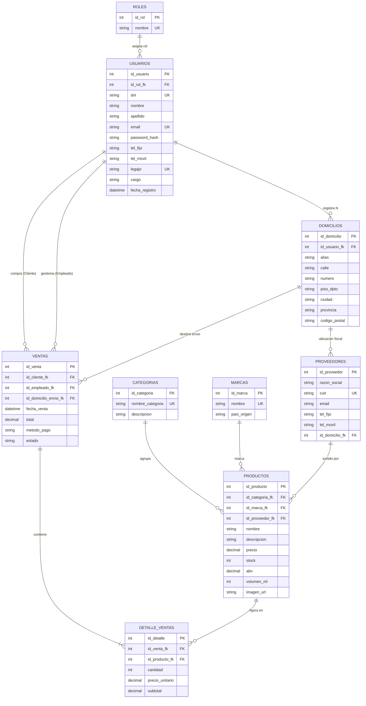

# Especificación de la Base de Datos — Moonshine Ballad

Diseño relacional, entidades, atributos, tipos de claves y relaciones que componen la base de datos.

---

## 🎨 Diagrama de Entidades y Relaciones (Mermaid.js)

---

## 📑 Especificación de Tablas y Atributos

### 1. Rol (`roles`)

- **`id_rol`** (PK, INT, Auto-increment) — Identificador único del rol.
- **`nombre`** (VARCHAR(30), Unique) — Nombre del rol (`Admin`, `Cliente`).

---

### 2. Usuario (`usuarios`)

- **`id_usuario`** (PK, INT, Auto-increment) — Identificador del usuario.
- **`id_rol_fk`** (FK, INT) — Referencia a `roles`.
- **`dni`** (VARCHAR(20), Unique) — DNI / Documento de identidad.
- **`nombre`** (VARCHAR(30)) — Nombre del usuario.
- **`apellido`** (VARCHAR(30)) — Apellido del usuario.
- **`email`** (VARCHAR(40), Unique) — Correo electrónico de acceso.
- **`password_hash`** (VARCHAR(255)) — Hash bcrypt de la contraseña.
- **`tel_fijo`** (VARCHAR(20), Nullable) — Teléfono de contacto fijo.
- **`tel_movil`** (VARCHAR(20), Nullable) — Teléfono de contacto móvil.
- **`legajo`** (VARCHAR(20), Unique, Nullable) — Legajo administrativo (para empleados).
- **`cargo`** (VARCHAR(30), Nullable) — Cargo o puesto ocupado (para empleados).
- **`fecha_registro`** (DATETIME) — Fecha de alta en la plataforma.

---

### 3. Domicilio (`domicilios`)

- **`id_domicilio`** (PK, INT, Auto-increment) — Identificador único de la dirección.
- **`id_usuario_fk`** (FK, INT, Nullable) — Usuario propietario de la dirección.
- **`alias`** (VARCHAR(30)) — Etiqueta descriptiva (ej: *Casa*, *Trabajo*).
- **`calle`** (VARCHAR(50)) — Nombre de la arteria o calle.
- **`numero`** (VARCHAR(10)) — Numeración o altura.
- **`piso_dpto`** (VARCHAR(10), Nullable) — Piso y/o departamento.
- **`ciudad`** (VARCHAR(30)) — Localidad o ciudad.
- **`provincia`** (VARCHAR(30)) — Provincia o estado.
- **`codigo_postal`** (VARCHAR(15)) — Código postal.

---

### 4. Categoria (`categorias`)

- **`id_categoria`** (PK, INT, Auto-increment) — Identificador de la categoría.
- **`nombre_categoria`** (VARCHAR(30), Unique) — Ej: *Single Malt*, *Bourbon*, *Rye*, *Blended*.
- **`descripcion`** (TEXT, Nullable) — Descripción detallada de la variante de destilado.

---

### 5. Marca (`marcas`)

- **`id_marca`** (PK, INT, Auto-increment) — Identificador único de la marca.
- **`nombre`** (VARCHAR(30), Unique) — Nombre comercial de la destilería / marca.
- **`pais_origen`** (VARCHAR(30)) — País de origen (Escocia, EE.UU., Irlanda, Japón).

---

### 6. Proveedor (`proveedores`)

- **`id_proveedor`** (PK, INT, Auto-increment) — Identificador del proveedor.
- **`razon_social`** (VARCHAR(30)) — Razón social o firma comercial.
- **`cuit`** (VARCHAR(20), Unique) — Clave de identificación fiscal (CUIT).
- **`email`** (VARCHAR(40)) — Correo electrónico de contacto.
- **`tel_fijo`** (VARCHAR(20)) — Teléfono fijo de oficina.
- **`tel_movil`** (VARCHAR(20)) — Teléfono móvil comercial.
- **`id_domicilio_fk`** (FK, INT, Nullable) — Referencia al domicilio fiscal en `domicilios`.

---

### 7. Producto (`productos`)

- **`id_producto`** (PK, INT, Auto-increment) — Identificador del producto.
- **`id_categoria_fk`** (FK, INT) — Referencia a `categorias`.
- **`id_marca_fk`** (FK, INT) — Referencia a `marcas`.
- **`id_proveedor_fk`** (FK, INT, Nullable) — Referencia a `proveedores`.
- **`nombre`** (VARCHAR(30)) — Nombre comercial del whisky.
- **`descripcion`** (TEXT) — Notas de cata y descripción técnica.
- **`precio`** (DECIMAL(10, 2)) — Precio de venta unitario.
- **`stock`** (INT) — Unidades disponibles en almacén.
- **`abv`** (DECIMAL(4, 1)) — Graduación alcohólica (% ABV).
- **`volumen_ml`** (INT) — Volumen en mililitros (ej: 750, 1000).
- **`imagen_url`** (VARCHAR(255), Nullable) — Ruta o enlace a la imagen del producto.

---

### 8. Venta (`ventas`)

- **`id_venta`** (PK, INT, Auto-increment) — Identificador de la transacción.
- **`id_cliente_fk`** (FK, INT) — Referencia a `usuarios` (cliente comprador).
- **`id_empleado_fk`** (FK, INT, Nullable) — Referencia a `usuarios` (empleado que procesa).
- **`id_domicilio_envio_fk`** (FK, INT) — Referencia a `domicilios` (dirección de destino).
- **`fecha_venta`** (DATETIME) — Fecha y hora de confirmación de la venta.
- **`total`** (DECIMAL(12, 2)) — Monto total de la orden.
- **`metodo_pago`** (VARCHAR(30)) — Método de pago (Efectivo, Tarjeta, Transferencia).
- **`estado`** (VARCHAR(20)) — Estado del pedido (Pendiente, Pagado, Enviado, Cancelado).

---

### 9. Detalle_Venta (`detalle_ventas`)

- **`id_detalle`** (PK, INT, Auto-increment) — Identificador del renglón de detalle.
- **`id_venta_fk`** (FK, INT) — Referencia a `ventas`.
- **`id_producto_fk`** (FK, INT) — Referencia a `productos`.
- **`cantidad`** (INT) — Unidades compradas.
- **`precio_unitario`** (DECIMAL(10, 2)) — Precio congelado al momento de la venta.
- **`subtotal`** (DECIMAL(10, 2)) — Columna calculada (`cantidad` * `precio_unitario`).

---

## 🔗 Resumen de Relaciones y Cardinalidades

1. **`roles` 1 : N `usuarios`** — Un rol (Admin/Cliente) asigna permisos a múltiples usuarios.
2. **`usuarios` 1 : N `domicilios`** — Un usuario cliente puede registrar de 0 a N direcciones.
3. **`domicilios` 1 : N `proveedores`** — Un domicilio fiscal asociado a un proveedor.
4. **`categorias` 1 : N `productos`** — Una categoría agrupa múltiples whiskies.
5. **`marcas` 1 : N `productos`** — Una marca embotella múltiples whiskies.
6. **`proveedores` 1 : N `productos`** — Un proveedor surte variados licores.
7. **`usuarios` (Cliente) 1 : N `ventas`** — Un cliente realiza cero, una o muchas compras.
8. **`usuarios` (Empleado) 1 : N `ventas`** — Un empleado gestiona cero, una o muchas ventas.
9. **`domicilios` 1 : N `ventas`** — Un domicilio sirve como destino de envío de 0 a N ventas.
10. **`ventas` 1 : N `detalle_ventas`** — Una venta contiene de 1 a N renglones de detalle.
11. **`productos` 1 : N `detalle_ventas`** — Un producto se incluye en múltiples detalles de venta.